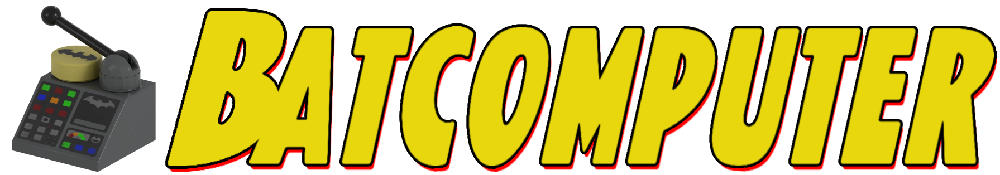

[](https://loomirr.github.io/Batcomputer/)

Create suits, characters, equipment and vehicles for **LEGO Batman: Legacy of the Dark Knight** using assets from your own game.

**[Download Batcomputer 1.1](https://github.com/Loomirr/Batcomputer/releases/tag/v1.1.0)** · **[Documentation](https://loomirr.github.io/Batcomputer/)** · **[What's new](docs/releases/1.1.0.md)** · **[Report a bug](https://github.com/Loomirr/Batcomputer/issues)**

## Get started

1. Download **Batcomputer-update-win-x64.zip** from the release page and extract the entire ZIP to a writable folder, such as `C:\Tools\Batcomputer`.
2. Keep `Batcomputer.exe` and its `app/` folder together. The Windows x64 release includes .NET; no separate .NET installation is needed.
3. Follow [first-time setup](https://loomirr.github.io/Batcomputer/getting-started/setup/), then [build your first suit](https://loomirr.github.io/Batcomputer/guides/first-suit/).

Already using Batcomputer? Open **Updates → Check for updates**. Stable 1.1 is available on both update channels. Back up editable projects before upgrading.

## Make it your own

- **Characters and suits:** combine native parts, custom bodies, materials and textures; reuse base-character assets and explicitly refresh inherited settings.
- **Animation and voice:** browse native clips, author animations, import compatible actions, edit named bone groups and build character-local voice profiles.
- **Icons:** generate individual icons or all four character slots, tune cameras and lighting, and share JSON presets.
- **Abilities and equipment:** edit supported loadouts, choose body-matched takedown/dodge sets, and customize held items and equipment.
- **Vehicles:** import native-rig bodies, place parts and seats, edit materials in place and move multiple parts together.
- **Build and share:** inspect build findings, follow detailed progress and export installable ZIPs with readable output paths.

Some advanced workflows remain experimental. See the [guides and limitations](https://loomirr.github.io/Batcomputer/) before replacing rigs or mixing gameplay systems.

## What you need

To author mods: a local game installation, matching game-build mappings, Unreal Engine 5.6 for Asset Registry generation, and the current **Loomirr's LOTDK UE4SS** framework. Install that framework separately; it is not bundled with Batcomputer.

Players using finished mods need the mod and the compatible LOTDK UE4SS framework, not Batcomputer or its authoring tools. Optional Oodle compression uses your locally supplied runtime; Batcomputer does not distribute it.

**[Setup](https://loomirr.github.io/Batcomputer/getting-started/setup/)** · **[Updating and recovery](https://loomirr.github.io/Batcomputer/guides/app-updates/)** · **[Troubleshooting](https://loomirr.github.io/Batcomputer/help/troubleshooting/)**

## Source repository

| Folder | Contents |
| --- | --- |
| `src/Batcomputer/` | Desktop app, services, artwork, embedded web UI and native support |
| `Tools/` | Build, import, documentation and release helpers |
| `docs/` | User guides, release notes and reference documentation |
| `gamedata/` | Versioned reference catalogs |
| `licenses/` | Dependency notices and native build provenance |
| `.usmap/` | Published mappings endpoint; path kept stable for clients |

With the **.NET 10 SDK** installed:

```powershell
dotnet build Batcomputer.csproj
dotnet run --project Batcomputer.csproj
```

Build output, private test packs, generated projects and local caches are not release source. See [Tools/README.md](Tools/README.md) for helper workflows.

## License and game content

Batcomputer is [MIT licensed](LICENSE); bundled dependencies have their own [notices](THIRD_PARTY_NOTICES.md). This repository does not include extracted game textures, meshes, cooked assets, or proprietary game runtimes. Use assets from your own game and do not redistribute extracted game content.

Not affiliated with TT Games, Warner Bros. Games or the LEGO Group.
