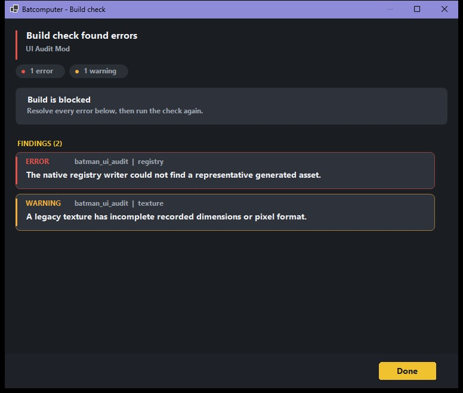
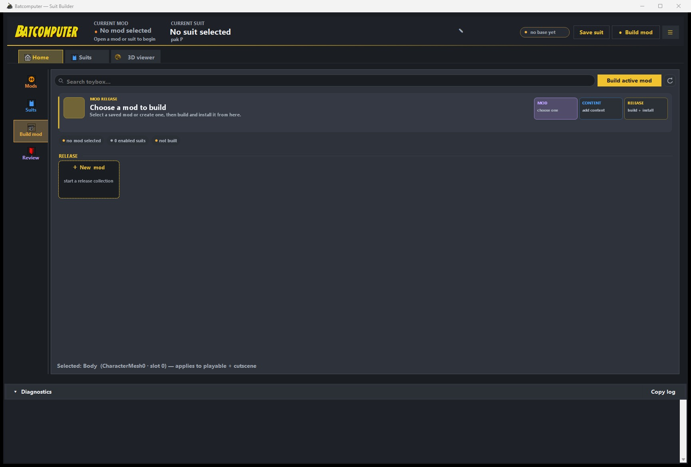
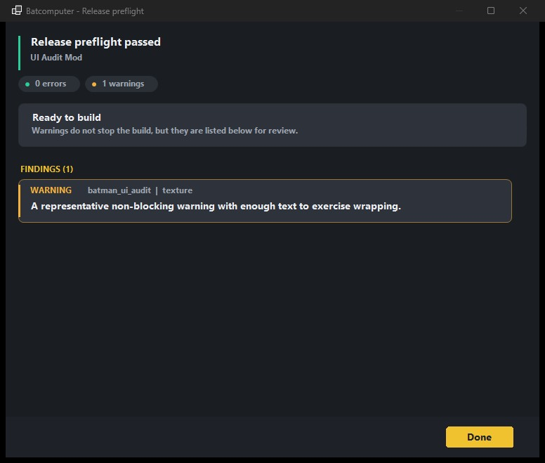

# Build, test, and share

## Run the build check

Open the mod and choose **Check mod**. Errors block packaging; warnings identify content that
needs review but may still be intentional.

Typical blockers include:

- Duplicate suit IDs, PawnTags, or DCMD package paths.
- Missing cooked texture payloads.
- Invalid or stale donor assets.
- Missing UIMD/DCMD/StringTable output.
- An unavailable Asset Registry writer.
- A third-party mod build with no compatible Loomirr's LOTDK UE4SS installation.

{ .bc-doc-shot loading=lazy }

## Build and install

Close the game before building, then choose **Build mod**:

{ .bc-doc-shot loading=lazy }

*Some screenshots show an earlier layout. Archive import/export actions are under
Home → Import/Export; Build mod is for checking and building.*

1. Stages every enabled suit, vehicle and shared mod asset. Vehicle-only mods are supported.
2. Validates the staged cooked data.
3. Writes gameplay tags and native Asset Registry data.
4. Builds the pak/ucas/utoc trio.
5. Installs the completed build into the configured game.

Batcomputer installs only a fresh, complete pak/ucas/utoc trio from the current build. If packaging
or installation fails, it does not publish a partial trio over the last working install.

Restart the game after each new installation. Unreal discovers tags, registry rows, and primary
assets during startup.

Registry loading bundles are rebuilt from each suit's final staged character metadata, including
its playable/cinematic actors, equipment entries and upgrade references. Referenced custom
equipment entries also register their definition-loading bundle. Missing staged custom dependencies
or unreadable metadata stop the build; native and DLC dependencies are referenced without being
overwritten. These are Batcomputer packaging changes and do not require a runtime DLL update.

{ .bc-doc-shot loading=lazy }

## Test matrix

Test at least:

| Area | Check |
| --- | --- |
| Menu discovery | Correct character submenu, tile count, name, description, and icon. |
| Hover | Stable preview with the expected materials and parts. |
| Selection | Native swap animation and correct playable pawn. |
| Gameplay | Movement, equipment, glider, abilities, and animation behavior. |
| Animation override | Trigger the replaced action, its transitions, and reset-to-donor path on a duplicate test suit. |
| Persistence | Back out to frontend, reload gameplay, then fully restart the game. |
| Compatibility | Test beside at least one other custom suit mod using Loomirr's LOTDK UE4SS. |

For inspecting or removing saved edits first, use [Review](review-changes.md). Recorded edit statuses
are not a substitute for these build and gameplay checks.

## Watching a build

Mod builds and suit packaging open a resizable progress window with the current phase,
content item, elapsed time, and timestamped activity. Combined mod builds also show the
current character/suit or vehicle number. The activity bar is indeterminate when the tools
cannot report a reliable percentage.

Scroll up in the log to read earlier messages without following new output; scroll back
to the bottom to follow again. **Copy activity log** copies the recent output displayed in
the window. The window keeps a bounded recent history, while the full output remains in
**Diagnostics** after it closes. Closing this window is not a build-cancellation command.

Release ZIP creation uses the same detailed view, with the current archive entry, file count,
bytes read and elapsed time. Compression runs in the background. The previous ZIP is only
replaced after the new archive finishes successfully.

After building/installing or creating a ZIP, the result window shows selectable, wrapped
paths. Use **Copy path**, **Copy all paths**, or **Open folder** (for existing locations).
Resize the window or scroll to reach every location; long paths are not shortened with ellipses.
The ZIP result also shows archive size and, when the game location is configured, the extraction
folder for this PC. Recipients should use their own Steam library's `steamapps/common` folder.

## Create the ZIP

On **Home** → **Import/Export**, select your mod and choose **Create release ZIP** after a successful build. The archive
includes the Steam game folder above `LEGOBatmanLotDK`. Extract into your Steam library's
`steamapps/common` directory as shown in the result dialog, or use a compatible mod manager.
Check the ZIP's top-level folder before extracting; do not nest a second game folder inside the first.

Suit releases require Loomirr's LOTDK UE4SS. They must not include or overwrite its shared
`LOTDKExpandedCoreRegistry`.

## Share an editable project

The release ZIP is for players. To let another creator continue editing a mod, select it on
**Home** → **Import/Export** and choose **Export editable copy**. The creator archive contains the
saved mod, suit and vehicle recipes plus source images, meshes, their project-owned import caches,
and cooked custom materials with their texture dependencies. Save your edits before exporting.
Native game assets remain references; the game itself, UE4SS, mappings and saves are not included.

The recipient chooses **Home** → **Import/Export** → **Import editable mod**. Import refuses a duplicate Mod ID, suit ID or
vehicle ID, pawn tag or character package. An existing identical shared material can be reused;
a different material at the same package path blocks import. Use a clean workspace for a direct handoff, then review the native donors, run a current
extraction/refresh, and rebuild before installing. The source files are copied into the receiving
workspace, so later edits do not depend on the sender's folders.

Re-export archives made with the earlier experimental sharing format. Missing source files now
stop export with an explanation. Imported custom animation libraries are not transferred yet;
projects referencing them are rejected rather than exported with missing dependencies.

See [Import and export projects](import-export.md) for the step-by-step handoff and conflict checks.

## Before publishing

- Custom equipment: use the [Equipment workshop checklist](equipment-workshop.md#limits-and-testing), including separate projectile variants and a native-suit control test.
- Back up your project and source textures or OBJ files.
- Confirm the Mod ID is final.
- Include Loomirr's LOTDK UE4SS and the compatible game build in requirements.
- Do not bundle Batcomputer, Unreal Engine, mappings, your full game extraction or unrelated source/reference files.
- Provide a short list of included suits and known limitations.
- Cold-test the exact ZIP you intend to upload.

The ZIP is the thing to test and share. Do not replace files inside it after the final test; rebuild
the archive instead.
